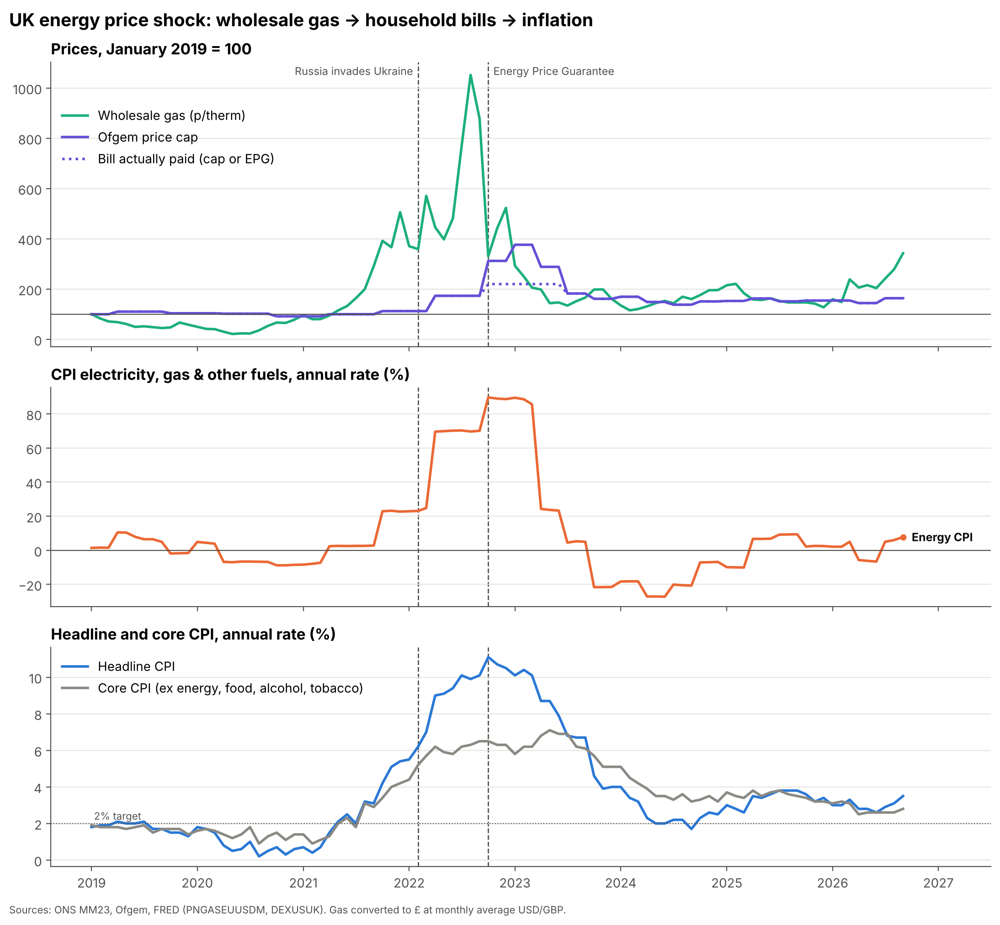
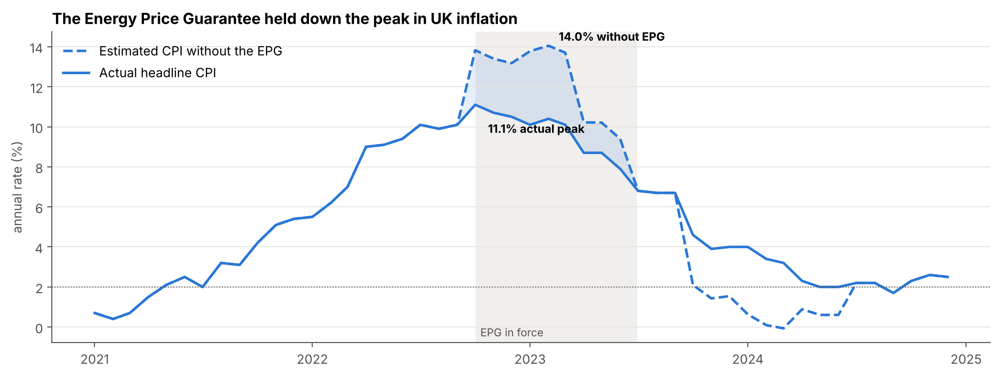

# How much did the 2021–23 energy price shock drive UK inflation?

## Background
UK inflation hit 11.1% in October 2022, and most of the coverage at the time blamed energy. I wanted to check that with the data: how much of the 2021–23 rise in inflation came from energy, and how long did wholesale gas price rises take to reach household bills (the Ofgem price cap) and CPI?

I also wanted to see what Python can really do. A real economics question felt like a more valuable introduction than a tutorial, and after my dissertation I wanted to stay within the energy sector.

## Data
Monthly, January 2015 to September 2026.
- **ONS** MM23 consumer price inflation: headline CPI (D7G7), core CPI (DKO8), CPI electricity, gas & other fuels (04.5) and basket weights
- **Ofgem** energy price cap (typical dual-fuel bill, `data/ofgem_price_cap.csv`)
- **FRED**: European natural gas (PNGASEUUSDM), Brent crude (DCOILBRENTEU), USD/GBP (DEXUSUK), HICP 04.5 for France and Germany
- **Bank of England**: Bank Rate (IUDBEDR)
- **Our World in Data** (Ember / Energy Institute): electricity generation by source

## Method
1. **Lined the data up.** Put every series on the same monthly timeline, converted wholesale gas prices from dollars to pence per therm, and carried the price cap forward through the months between changes.
2. **Measured the delay.** Compared changes in gas prices with changes in the price cap (and bills with energy inflation), shifting them by 0 to 12 months to see which delay matched best.
3. **Measured the size.** Used a regression to estimate how much of a rise in wholesale gas ends up in household energy prices over the following 12 months.
4. **Split up inflation.** Compared headline and core inflation, and estimated energy's share of the total from its weight in the CPI basket and how fast its price was rising.
5. **Looked at the Energy Price Guarantee.** Worked out the saving for a typical household, and estimated what inflation would have been if bills had followed the Ofgem cap instead.
6. **Compared the response.** Checked when the Bank of England first raised rates against when inflation passed 2%, and compared the UK with France and Germany.

## Key findings
1. **There's a delay.** Wholesale gas price changes took about 6 months to show up in the Ofgem price cap. Once bills changed, inflation moved the same month. A sustained 10% rise in wholesale gas pushed household energy prices up by about 2% within a year.
2. **Energy was about a third of the peak.** Household energy added around 3.5 percentage points to inflation in October 2022, when it hit 11.1%. Without the £2,500 Energy Price Guarantee, I estimate inflation would have peaked at about 14%, and a typical household saved around £900.
3. **The Bank of England waited.** Inflation went above the 2% target in May 2021, seven months before the first rate rise in December 2021. In real terms (Bank Rate minus inflation), interest rates fell to about −8.8%.

## What this means now
Gas prices are climbing again. In my data, wholesale gas roughly doubled between December 2025 and September 2026, from about 71p to 190p a therm. That's still only around a third of the 2022 peak, but if the six-month lag I found holds, it points to higher price caps over the next few quarters. You can already see the start of it: the cap went up to £1,862 in July 2026, and household energy inflation was back to 7.8% by September. It's nowhere near a repeat of 2022 so far, but it's the same chain playing out again, and I'd like to come back to it once a few more months of data are out.

## Limitations
Correlation isn't causation: other shocks (post-Covid demand, supply chains, a weaker pound) overlapped with the energy shock. The counterfactual is first-round only, and Ofgem's typical-household consumption changed in 2020 and 2023.

## Run it
Install the packages with `pip install -r requirements.txt`, then open `uk_energy_inflation.ipynb` in Jupyter and run all the cells. The notebook uses the copies of the data saved in `data/`, and downloads fresh copies for anything that's missing.
